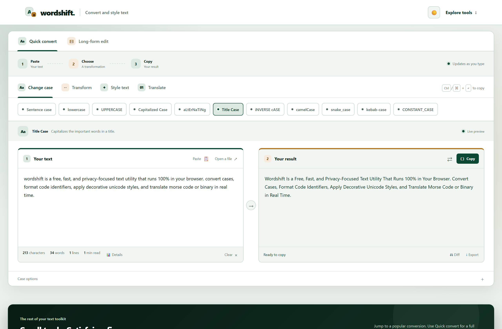
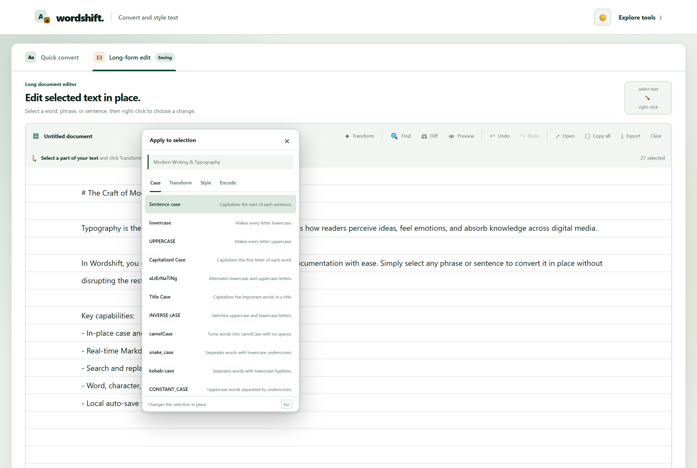
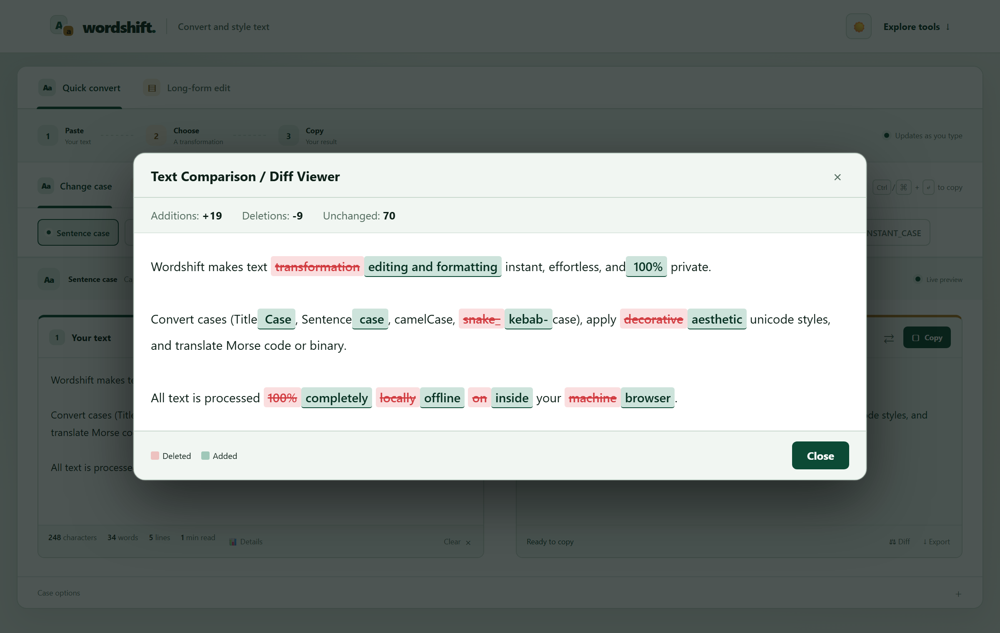
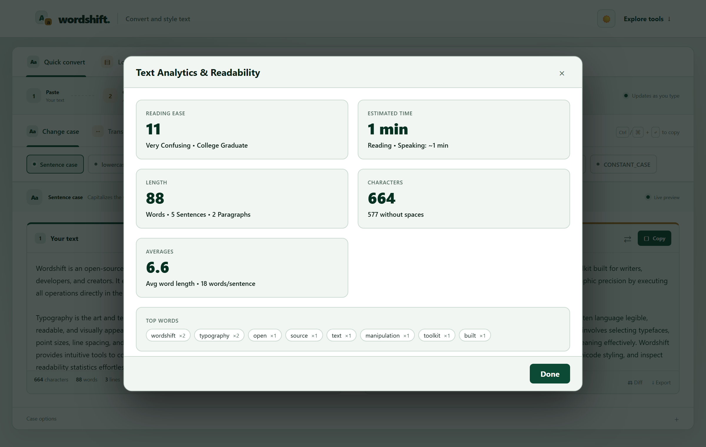
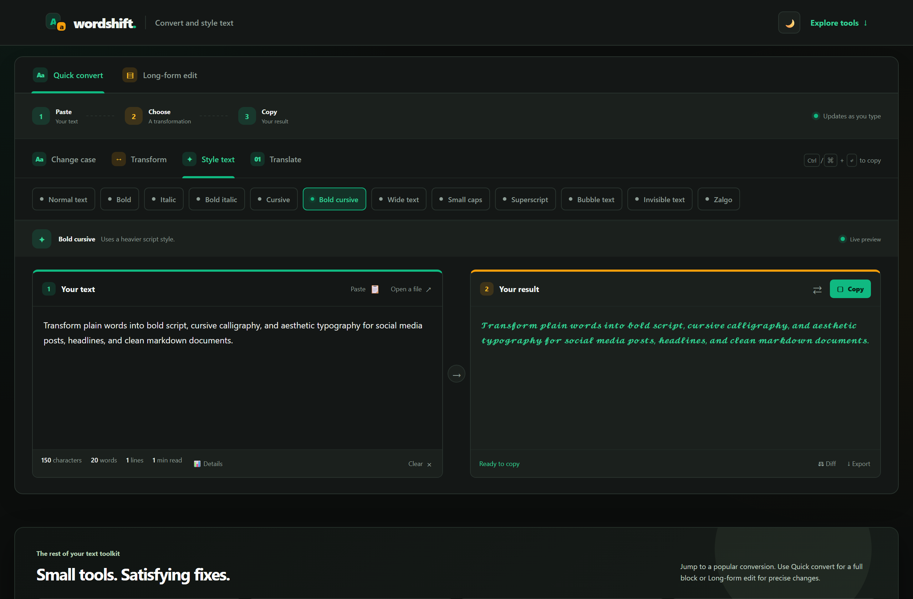

<div align="center">

  

  # Wordshift

  ### Convert, Style, and Edit Text Effortlessly

  <p>
    A fast, privacy-focused text converter, Unicode styler, and in-place document editor.<br>
    Runs 100% in your browser with zero dependencies, zero tracking, and full offline PWA support.
  </p>

  <p>
    <a href="https://wordshift.nobojit.com/"><strong>Explore the Live Application »</strong></a>
  </p>

  <p>
    <a href="https://wordshift.nobojit.com/"></a>
    <a href="https://github.com/nobojithalder/Wordshift"></a>
    <a href="LICENSE"></a>
    
    
  </p>

</div>

---

<div align="center">
  
</div>

---

## 📑 Table of Contents

- [Overview](#-overview)
- [Live Demo & Repository](#-live-demo--repository)
- [Key Features](#-key-features)
  - [1. Quick Convert Mode](#1-quick-convert-mode)
  - [2. Long-Form Document Editor](#2-long-form-document-editor)
  - [3. Visual Diff Comparison](#3-visual-diff-comparison)
  - [4. Text Analytics & Readability Metrics](#4-text-analytics--readability-metrics)
  - [5. Audio Morse Code Synthesizer](#5-audio-morse-code-synthesizer)
  - [6. Dark & Light Theme](#6-dark--light-theme)
  - [7. Import, Export & Print Layouts](#7-import-export--print-layouts)
  - [8. Progressive Web App (PWA) & Offline Mode](#8-progressive-web-app-pwa--offline-mode)
- [All 37+ Supported Transformations](#-all-37-supported-transformations)
  - [Change Case (11 Tools)](#change-case)
  - [Transform & Clean (9 Tools)](#transform--clean)
  - [Style Text & Unicode (12 Tools)](#style-text--unicode)
  - [Translate & Encode (5 Tools)](#translate--encode)
- [Keyboard Shortcuts](#-keyboard-shortcuts)
- [Privacy & Security](#-privacy--security)
- [Project Architecture](#-project-architecture)
- [Running Locally](#-running-locally)
- [Author & License](#-author--license)

---

## 🌟 Overview

Most online text utility websites are bloated with intrusive banner ads, slow scripts, or transmit user clipboard data to remote web servers.

**Wordshift** was created to be the cleanest, fastest, and most privacy-respecting text workstation on the web:
- **100% Client-Side**: Every transformation, calculation, and regex operation executes strictly inside your browser. No analytics, no server logging, no data transmission.
- **Dual-Mode Workflow**: Switch seamlessly between **Quick Convert** (for fast, one-off text transformations) and **Long-Form Edit** (for drafting articles and editing specific selections in place).
- **Zero Dependencies**: Built with pure semantic HTML5, modern vanilla ES6+ JavaScript, and responsive CSS3 variables. No build step, no Node modules, and no third-party framework overhead.

---

## 🔗 Live Demo & Repository

- **🌐 Live Production Website:** [https://wordshift.nobojit.com/](https://wordshift.nobojit.com/)
- **💻 GitHub Source Code:** [https://github.com/nobojithalder/Wordshift](https://github.com/nobojithalder/Wordshift)

---

## ✨ Key Features

### 1. Quick Convert Mode

Quick Convert is designed for frictionless, rapid copy-paste editing:
- **Instant Live Preview**: Transformations update asynchronously in real time as you type or paste.
- **Word & Character Statistics**: Displays live character count, word count, line count, and estimated reading time.
- **Smart Brand Term Preservation**: Define custom brand or casing exceptions (e.g. `iPhone`, `OpenAI`, `NASA`, `JavaScript`) so sentence and title casing preserve your capitalization rules.
- **Quick Action Rail**: One-click swap input/output, copy to clipboard with tactile feedback, or clear workbench.

---

### 2. Long-Form Document Editor

<div align="center">
  
</div>

Unlike standard text converters that force you to transform entire documents at once, Wordshift includes a dedicated editor tailored for essays, documentation, and articles:
- **Contextual In-Place Transformations**: Highlight any word, phrase, or paragraph and right-click (or click **✦ Transform**) to apply any transformation *only* to the selected text. The rest of your document remains untouched.
- **Live Markdown Preview**: Toggle side-by-side or split preview to render Markdown headings, lists, bold/italics, and blockquotes in real time.
- **Full Find & Replace Suite**:
  - Match Case (`Aa`), Whole Word (`W`), and Regular Expressions (`.*`).
  - Active match counter (e.g. `3 of 12`) with smooth up/down keyboard navigation (`Enter` / `Shift+Enter`).
  - Replace current match or **Replace All** with a single click.
- **Reliable Undo / Redo Stack**: State-based history preserving your editing history across in-place modifications.
- **Draft Auto-Save & Recovery**: Automatically preserves work in browser `localStorage`. If you accidentally close or refresh the tab, your draft is restored instantly.

---

### 3. Visual Diff Comparison

<div align="center">
  
</div>

Verify exact changes before publishing or copying:
- **Character & Word Diff Engine**: Visually highlights additions in green (`<ins>`) and deletions in red (`<del>`).
- **Diff Summary Statistics**: Displays exact counts of added characters (`+`), deleted characters (`-`), and unchanged content.
- Available in both Quick Convert mode (comparing Input vs. Result) and Document mode (comparing your document against its previous undo state).

---

### 4. Text Analytics & Readability Metrics

<div align="center">
  
</div>

Gain deep linguistic insights into your writing with the built-in analytics suite:
- **Flesch Reading Ease**: Scientific score from 0 to 100 rating how easy your copy is to comprehend.
- **Flesch-Kincaid Grade Level**: Corresponds text complexity to educational grade level (e.g. *8th Grade*, *College Level*).
- **Time Estimates**: Estimated reading time (at 200 WPM) and speaking presentation time (at 130 WPM).
- **Comprehensive Structure Breakdown**: Word counts, character counts (with and without spaces), sentence counts, paragraph counts, syllable counts, and lexical density percentage.
- **Top Keyword Frequency**: Visual chips highlighting your most repeated words and their frequencies.

---

### 5. Audio Morse Code Synthesizer

Wordshift features a built-in real-time audio player using the **Web Audio API**:
- Translates any plain text into international Morse code (`.-`).
- Synthesizes authentic acoustic audio beeps with calibrated dit lengths, dah intervals, intra-character spacing, and letter pauses.
- Includes smooth gain ramping to prevent audio popping.

---

### 6. Dark & Light Theme

<div align="center">
  
</div>

- **Auto-Detection**: Synchronizes automatically with your operating system's light or dark mode preference.
- **Instant Toggle**: Switch themes on the fly using the header toggle button.
- **Persistence**: Remembers your preferred theme across browser sessions.

---

### 7. Import, Export & Print Layouts

- **Universal File Input**: Drag and drop or open `.txt`, `.md`, `.csv`, `.html`, `.json`, `.xml`, or `.log` files directly into either editor.
- **Multi-Format Export**:
  - Plain Text (`.txt`)
  - Markdown (`.md`)
  - Standalone HTML document (`.html`)
  - Formatted Print / Save as PDF layout

---

### 8. Progressive Web App (PWA) & Offline Mode

- **Installable**: Install Wordshift directly onto Windows, macOS, Linux, Android, or iOS as a native standalone app.
- **Zero-Network Functionality**: Powered by a Service Worker (`sw.js`) that caches all static assets locally. Use Wordshift completely offline, on flights, or in remote environments.

---

## 🛠️ All 37+ Supported Transformations

### Change Case

| Tool | Format | Example Input | Example Output |
| :--- | :--- | :--- | :--- |
| **Sentence case** | Capitalizes start of sentences & terms | `welcome to wordshift. try it out!` | `Welcome to wordshift. Try it out!` |
| **lowercase** | All characters lower | `The Quick Brown FOX` | `the quick brown fox` |
| **UPPERCASE** | All characters upper | `The Quick Brown FOX` | `THE QUICK BROWN FOX` |
| **Capitalized Case** | Capitalize every word | `the quick brown fox` | `The Quick Brown Fox` |
| **aLtErNaTiNg** | Staggered alternating letters | `hello world` | `hElLo WoRlD` |
| **Title Case** | Capitalizes major words, keeps minor lowercase | `the lord of the rings: the return of the king` | `The Lord of the Rings: The Return of the King` |
| **iNVERSE cASE** | Inverts case of each letter | `Hello World!` | `hELLO wORLD!` |
| **camelCase** | Removes spaces, capitalizes subsequent words | `user profile settings` | `userProfileSettings` |
| **snake_case** | Lowercase separated by underscores | `user profile settings` | `user_profile_settings` |
| **kebab-case** | Lowercase separated by hyphens | `user profile settings` | `user-profile-settings` |
| **CONSTANT_CASE** | Uppercase separated by underscores | `user profile settings` | `USER_PROFILE_SETTINGS` |

---

### Transform & Clean

| Tool | Description | Example Input | Example Output |
| :--- | :--- | :--- | :--- |
| **Reverse text** | Reads backwards character-by-character | `Antigravity` | `ytivargitnA` |
| **Upside down** | Flips glyphs 180° using Unicode | `Wordshift` | `ʇɟᴉɥspɹoM` |
| **Mirror text** | Flips text horizontally | `Wordshift` | `ƚʇiʜƨbɿoW` |
| **Strikethrough** | Applies combining strikethrough characters | `Completed task` | `C̶o̶m̶p̶l̶e̶t̶e̶d̶ ̶t̶a̶s̶k̶` |
| **Underline** | Applies combining underline characters | `Important note` | `I̲m̲p̲o̲r̲t̲a̲n̲t̲ ̲n̲o̲t̲e̲` |
| **ROT13** | Shifts Latin letters by 13 positions | `Hello World` | `Uryyb Jbeyq` |
| **Clean spaces** | Trims extra spaces and collapses whitespace | `  Too    many   spaces   ` | `Too many spaces` |
| **Sort lines** | Alphabetically sorts lines of text | `Zebra\nApple\nMango` | `Apple\nMango\nZebra` |
| **Remove duplicates** | Deletes redundant repeating lines | `Red\nBlue\nRed` | `Red\nBlue` |

---

### Style Text & Unicode

| Tool | Style | Example Input | Example Output |
| :--- | :--- | :--- | :--- |
| **Normal text** | Strips Unicode styles back to plain ASCII | `𝑩𝒐𝒍𝒅 𝒔𝒄𝒓𝒊𝒑𝒕` | `Bold script` |
| **Bold** | Mathematical Bold Unicode | `Wordshift` | `𝐖𝐨𝐫𝐝𝐬𝐡𝐢𝐟𝐭` |
| **Italic** | Mathematical Italic Unicode | `Wordshift` | `𝑊𝑜𝑟𝑑𝑠ℎ𝑖𝑓𝑡` |
| **Bold italic** | Mathematical Bold Italic Unicode | `Wordshift` | `𝑾𝒐𝒓𝒅𝒔𝒉𝒊𝒇𝒕` |
| **Cursive** | Mathematical Script Unicode | `Wordshift` | `𝒲ℴ𝓇𝒹𝓈𝒽𝒾𝒻𝓉` |
| **Bold cursive** | Mathematical Bold Script Unicode | `Wordshift` | `𝓦𝓸𝓻𝓭𝓼𝓱𝓲𝓯𝓽` |
| **Wide text** | Fullwidth Latin glyphs | `Wordshift` | `Ｗｏｒｄｓｈｉｆｔ` |
| **Small caps** | Unicode small capital letters | `Wordshift` | `ᴡᴏʀᴅꜱʜɪꜰᴛ` |
| **Superscript** | Raised characters and digits | `Wordshift 123` | `ᵂᵒʳᵈˢʰⁱᶠᵗ ¹²³` |
| **Bubble text** | Circled alphanumeric glyphs | `Wordshift` | `Ⓦⓞⓡⓓⓢⓗⓘⓕⓣ` |
| **Invisible text** | Replaces characters with blank braille fillers | `Secret` | `ㅤㅤㅤㅤㅤㅤ` |
| **Zalgo** | Chaotic glitch effect using combining diacritics | `Glitch` | `G̶l̸i̷t̶c̴h̶` |

---

### Translate & Encode

| Tool | Bidirectional Support | Example Input | Example Output |
| :--- | :--- | :--- | :--- |
| **Morse code** | Text ⇄ International Morse | `SOS` | `... --- ...` |
| **Binary** | Text ⇄ 8-bit ASCII binary | `Hi` | `01001000 01101001` |
| **Base64** | Text ⇄ RFC 4648 Base64 | `Hello` | `SGVsbG8=` |
| **URL Encode** | Text ⇄ URI component encoding | `query parameter` | `query%20parameter` |
| **Wingdings** | Text ⇄ Symbol typography | `Wordshift` | `☼○◙♂↕•◘♂` |

---

## ⌨️ Keyboard Shortcuts

| Shortcut | Context | Action |
| :--- | :--- | :--- |
| <kbd>Ctrl</kbd> / <kbd>⌘</kbd> + <kbd>Enter</kbd> | Anywhere | Copy converted result or document text to clipboard |
| <kbd>Ctrl</kbd> / <kbd>⌘</kbd> + <kbd>F</kbd> | Long-Form Editor | Open Find & Replace toolbar |
| <kbd>Ctrl</kbd> / <kbd>⌘</kbd> + <kbd>Z</kbd> | Long-Form Editor | Undo last change |
| <kbd>Ctrl</kbd> / <kbd>⌘</kbd> + <kbd>Y</kbd> / <kbd>⇧ Shift</kbd> + <kbd>Z</kbd> | Long-Form Editor | Redo last change |
| <kbd>Enter</kbd> | Find & Replace Bar | Go to next match |
| <kbd>Shift</kbd> + <kbd>Enter</kbd> | Find & Replace Bar | Go to previous match |
| <kbd>Esc</kbd> | Any Modal / Menu | Close modal, selection menu, or find bar |

---

## 🔒 Privacy & Security

Wordshift is built from the ground up to guarantee user confidentiality:
- **No Remote Telemetry**: Zero Google Analytics, Facebook Pixel, tracking beacons, or analytics scripts.
- **Strict Content Security Policy (CSP)**: Blocks external network requests and ensures scripts execute exclusively from self-hosted sources.
- **Local Persistence Only**: Settings, themes, and drafts are saved exclusively in your browser's private `localStorage`.
- **Safe HTML Sanitization**: Document and diff renderers strictly sanitize all user input before injecting into the DOM, preventing Cross-Site Scripting (XSS).

---

## 📂 Project Architecture

```
Wordshift/
├── .github/
│   └── workflows/
│       └── deploy.yml          # Automated GitHub Pages CI/CD workflow
├── assets/
│   ├── logo.svg                # Vector brand logo
│   ├── og-image.png            # Open Graph social preview banner (1200x630)
│   └── screenshots/
│       ├── hero-banner.png     # Quick Convert mode showcase
│       ├── quick-convert-dark.png # Dark theme view
│       ├── document-editor.png # Long-Form Editor with in-place menu
│       ├── diff-modal.png      # Visual Diff Comparison modal
│       └── text-analytics.png  # Text Analytics & Readability modal
├── .gitattributes              # Git line endings & binary file specifications
├── .gitignore                  # Ignore rules for OS & editor artifacts
├── CNAME                       # GitHub Pages custom domain (wordshift.nobojit.com)
├── favicon.svg                 # Web application favicon icon
├── index.html                  # Semantic application markup & metadata
├── LICENSE                     # MIT Open Source License
├── manifest.webmanifest        # PWA configuration manifest
├── README.md                   # Comprehensive project documentation
├── robots.txt                  # Search engine crawling rules
├── script.js                   # Application logic, converters & audio engine
├── sitemap.xml                 # Search engine sitemap index
├── styles.css                  # Responsive design system & CSS variables
└── sw.js                       # Service Worker for offline PWA caching
```

---

## 🚀 Running Locally

Wordshift uses zero frameworks, build tools, or compilers. Running it is as simple as opening a web page:

1. Clone or download the repository:
   ```bash
   git clone https://github.com/nobojithalder/Wordshift.git
   cd Wordshift
   ```
2. **Double-click `index.html`** in your file manager to open it immediately in any browser (Chrome, Edge, Firefox, Safari).

*That's it! No servers, no Node.js, and no installations required.*

---

## 👤 Author & License

Created with passion by **Nobojit Halder**:
- **Website:** [wordshift.nobojit.com](https://wordshift.nobojit.com/)
- **GitHub:** [@nobojithalder](https://github.com/nobojithalder)

This project is licensed under the **MIT License**. See the [LICENSE](LICENSE) file for details.
